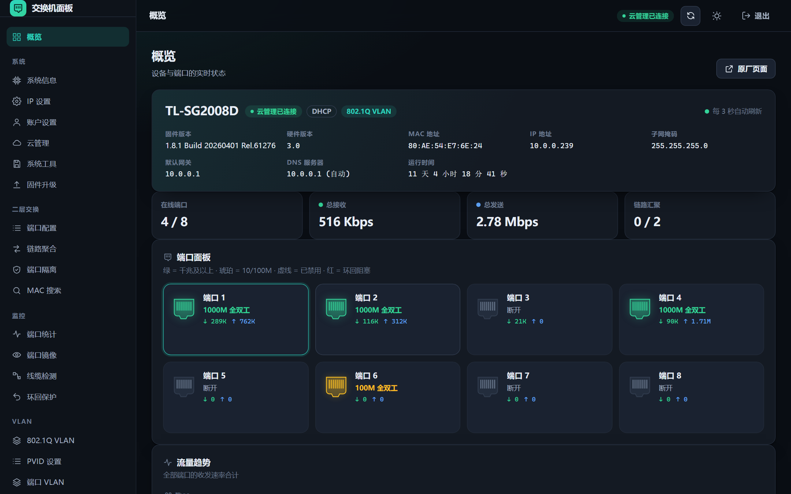
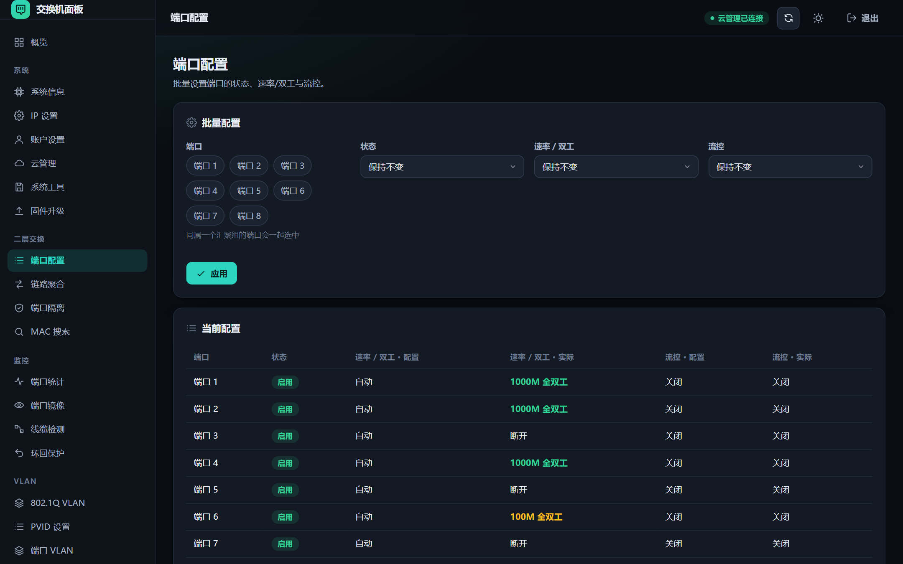
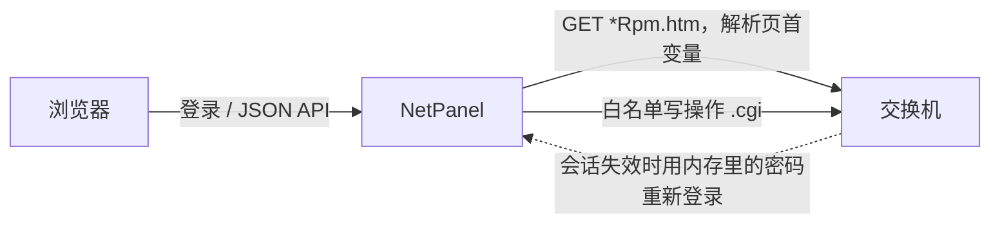

# NetPanel

[](https://github.com/LceAn/netpanel/actions/workflows/ci.yml)
[](https://nodejs.org)
[](app/package.json)

给局域网里的网络设备做的 Web 管理面板，用来替代原厂那套老页面。
第一个适配目标是 **TP-LINK TL-SG2008D**（硬件 3.0 / 固件 1.8.1）：原厂 22 个功能页全部覆盖，界面重新做了一遍。

- **零依赖**：只需要 Node.js ≥ 20，不用 `npm install`，没有构建步骤。
- **直接接管**：面板通过设备自己的 HTTP 接口读写配置，不刷固件、不改设备，随时可以回到原厂页面。
- **用设备账号登录**：不需要另外记一套账号密码，面板也不保存密码。

> 非官方项目，与 TP-LINK 无关联。写操作会改动正在运行的设备，请先看[已知限制](#已知限制)和[验证情况](#验证情况)。



## 功能

| 分组 | 页面 |
|---|---|
| 概览 | 设备信息、云管理状态、端口面板（实时速率 + 迷你趋势）、流量趋势、单端口快捷配置 |
| 系统 | 系统信息、IP 设置、固定 IP、账户设置、云管理、系统工具（保存配置 / 备份 / 还原 / 重启 / 恢复出厂）、固件升级 |
| 二层交换 | 端口配置、链路聚合、端口隔离、MAC 搜索 |
| 监控 | 端口统计（含单口报文明细和实时速率）、端口镜像、线缆检测、环回保护 |
| VLAN | 802.1Q VLAN、PVID、端口 VLAN、MTU VLAN |
| QoS | QoS 模式与端口优先级、带宽控制、风暴抑制 |

界面方面：深色 / 浅色主题（跟随系统，可手动切换并记住）、窄屏可用。
危险操作（重启、恢复出厂、改 IP、改账号、切换 VLAN 模式等）都要二次确认，恢复出厂需要输入 `RESET`。



## 快速开始

需要 Node.js 20 或更高版本，没有其它依赖。

```bash
git clone https://github.com/LceAn/netpanel.git
cd netpanel/app
node server.mjs
```

然后打开 <http://127.0.0.1:8208>，用**交换机的管理账号**登录。

Windows 下也可以直接双击 `app\start.cmd`。

## 配置

环境变量优先，其次读 `app/config.json`（可参考 `app/config.example.json`），都没有就用默认值：

| 配置 | 含义 | 默认值 |
|---|---|---|
| `SWITCH_URL` | 交换机地址 | `http://10.0.0.239` |
| `PANEL_HOST` | 面板监听地址 | `127.0.0.1`（仅本机） |
| `PANEL_PORT` | 面板端口 | `8208` |
| `PANEL_CONFIG` | 配置文件路径 | `app/config.json` |

```json
{
  "switchUrl": "http://10.0.0.239",
  "host": "127.0.0.1",
  "port": 8208
}
```

交换机用的是 DHCP，如果哪天它的 IP 变了，改 `SWITCH_URL` 后重启面板即可。

### 让局域网里的其它设备访问

先设置 `PANEL_HOST=0.0.0.0` 再启动，然后访问 `http://<这台电脑的 IP>:8208`。
面板本身只提供明文 HTTP、没有 TLS，**只建议在可信的内网里这样用**；需要跨网访问就自己套一层反向代理和认证。

## Docker

```bash
docker build -t netpanel ./app
docker run -d --name netpanel --restart unless-stopped \
  -p 8208:8208 -e SWITCH_URL=http://10.0.0.239 netpanel
```

容器要能访问到交换机所在网段。默认 bridge 网络一般可以出网；不行就加 `--network host`。

## 没有交换机也能跑

仓库里带了模拟交换机，用抓下来的原厂页面当数据，写操作随便试：

```bash
# 终端 1
node app/scripts/mock-switch.mjs

# 终端 2
SWITCH_URL=http://127.0.0.1:8269 node app/server.mjs
```

打开 <http://127.0.0.1:8208>，账号密码都是 `admin`。
模拟器会把收到的每个写请求打印到控制台，可以用来核对面板到底发了什么。

Windows CMD 里设置环境变量的写法是 `set SWITCH_URL=http://127.0.0.1:8269`。

## 它是怎么工作的



设备的 Web 接口是老式 CGI：每个功能页是一个 `XxxRpm.htm`，数据以 JS 变量的形式写在页面开头；
修改配置则是往对应的 `.cgi` 提交表单，并带上一串每次登录都会变的防跨站令牌（`g_tid`）。

面板做了这几件事：

1. **登录**：你用交换机账号登录面板，面板拿这个账号去登录交换机并保持会话。
   密码只在面板进程的内存里，交换机会话过期（实测空闲 8~15 分钟）时用它自动重新登录，不写盘。
2. **读**：请求原厂页面，用自己写的字面量解析器（`lib/jslite.mjs`）取出页首变量，整理成 JSON 给前端。
3. **写**：只能走白名单里的操作。每个操作都照搬原厂表单的提交方式（路径、编码、字段名、取值范围），
   参数先校验再发送，没有任何“把请求原样转发给交换机”的通道。写操作不自动重试（避免重复生效），
   连接中断时明确提示“结果未知”。
4. **安全**：面板自己的接口要求登录，写请求要求同源并带自定义请求头（防跨站伪造）；
   页面不拼接 HTML 字符串，设备返回的任何文本都作为纯文本显示。

## 目录

```
netpanel/
├─ app/                      面板本体
│  ├─ server.mjs             HTTP 服务：静态页面 + JSON 接口 + 登录鉴权
│  ├─ lib/
│  │  ├─ switch.mjs          设备客户端：登录、会话、请求队列、重试、重新登录
│  │  ├─ ops.mjs             写操作白名单：每个操作的参数校验与组包方式
│  │  ├─ pages.mjs           读页面注册表：把原厂页面里的数据整理成结构化 JSON
│  │  └─ jslite.mjs          解析原厂页面里的变量声明（只认字面量，不执行任何代码）
│  ├─ public/                前端（原生 JS，无框架）
│  ├─ scripts/mock-switch.mjs 模拟交换机
│  └─ test/                  单元测试
├─ tools/                    逆向分析时用的只读探测脚本
├─ _stock/                   从交换机上抓下来的原厂页面，测试夹具与对照资料
├─ docs/screenshots/         README 用的界面截图
└─ .github/workflows/        CI（Node 20 / 22 / 24 跑单元测试）
```

`_ref/`（调研时下载的第三方项目源码）和 `.zcode/`（本地工作目录）不入库，已在 `.gitignore` 里排除。

## HTTP 接口

面板前端只用下面这些接口，第三方脚本也可以直接调（需要先登录拿 Cookie，写操作要带 `X-Requested-With: switch-panel`）：

| 方法 | 路径 | 说明 |
|---|---|---|
| GET | `/api/health` | 存活检查，返回面板配置的设备地址 |
| GET | `/api/status` | 当前登录状态 |
| POST | `/api/login` | `{username, password}`，登录设备并建立面板会话 |
| POST | `/api/logout` | 退出并释放设备会话 |
| GET | `/api/overview` | 概览页数据 |
| GET | `/api/pages?keys=a,b` | 批量读取页面数据（最多 8 个） |
| GET | `/api/stats/:port` | 单端口统计与实时速率 |
| GET | `/api/backup` | 下载设备配置备份 |
| POST | `/api/op` | `{op, params}`，执行白名单写操作 |
| POST | `/api/mac-search` | MAC 地址搜索 |
| POST | `/api/restore` | 上传配置备份并还原 |
| POST | `/api/firmware/check` | 检查在线固件版本 |
| POST | `/api/firmware/upgrade` | 上传 `.bin` 固件升级 |
| POST | `/api/firmware/online` | 在线升级 |
| GET | `/api/firmware/job` | 查询升级任务进度 |

## 安全模型

- 面板不建账号体系，登录态就是这个设备会话；设备密码只存在服务进程内存里。
- 会话 Cookie 是 32 字节随机值，`HttpOnly` + `SameSite=Strict`，12 小时过期，后台定时回收。
- 写请求必须同源，并且带 `X-Requested-With: switch-panel`（浏览器里的跨站表单发不出来）。
- 所有响应带 CSP、`X-Frame-Options: DENY`、`nosniff`、`no-referrer`。
- 写操作只有 `lib/ops.mjs` 里的白名单，参数逐项校验；没有任意 URL 转发通道。
- 面板不保存设备密码到磁盘，也不把密码下发到浏览器。

## 测试

```bash
cd app
npm test        # 或 node --test，共 75 项
```

覆盖：解析器与读取模型（夹具是 `_stock/pages` 里的真实页面）、写操作校验与组包、
以及用本地 HTTP 服务冒充设备、录下客户端实际发出的请求内容的收发测试。

面板对着真机运行时，可以用 `tools/verify_panel.py` 做一次只读核对：它绕开面板的解析代码，
直接抓设备的原厂页面，和面板接口返回的数据逐项比对（需要先设置环境变量 `SW_USER` / `SW_PASS`）。
只依赖 Python 3 标准库。

## 验证情况

诚实地说清楚哪些测过、哪些没测：

- **读接口**：已在真机上逐个核对（型号、固件、端口状态、VLAN、统计计数等与原厂页面一致）。
- **写接口**：发给设备的内容已对着原厂页面里的表单逐字段核对，并在模拟交换机上走通了界面流程
  （批量改端口、添加 VLAN、重启、恢复出厂的确认与等待）。**但还没有在真机上真正执行过写操作**——
  写操作会改动正在运行的交换机，需要你点头后再做。原厂对写操作的返回格式（成功 / 失败提示）是推测的，
  首次在真机上使用时请先用“保持不变”这类无副作用的操作试一下。
- **固件升级**：流程按原厂页面的脚本实现，未实测（升级有风险，不建议为了测试而升级）。

## 已知限制

- 目前只适配 TL-SG2008D 这一代固件的页面体系（`*Rpm.htm`）。同系列的其它型号（口数不同、带 PoE、带光口）
  协议相同，但前端端口数量来自设备，PoE 和光口的界面还没做。
- 修改交换机 IP 后，面板连不上设备，需要改 `SWITCH_URL` 并重启面板（界面上有提示）。
- 交换机允许同一账号多会话并存，所以多个浏览器可以同时登录面板。
- 面板是单设备、单进程设计，没有持久化存储；重启后需要重新登录。
- 只支持 `http://` 连接设备，不支持 HTTPS 管理地址。

## 免责声明

本项目按“现状”提供，不附带任何担保。用它改配置、重启或升级固件造成的网络中断、配置丢失或设备故障，
由使用者自行承担。动手前先备份配置。
