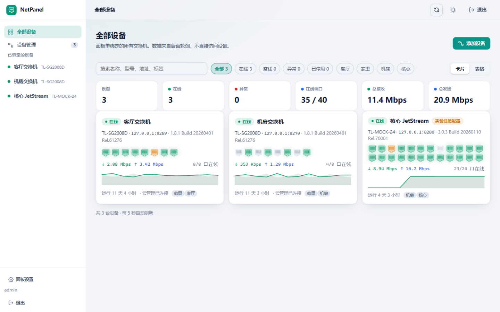
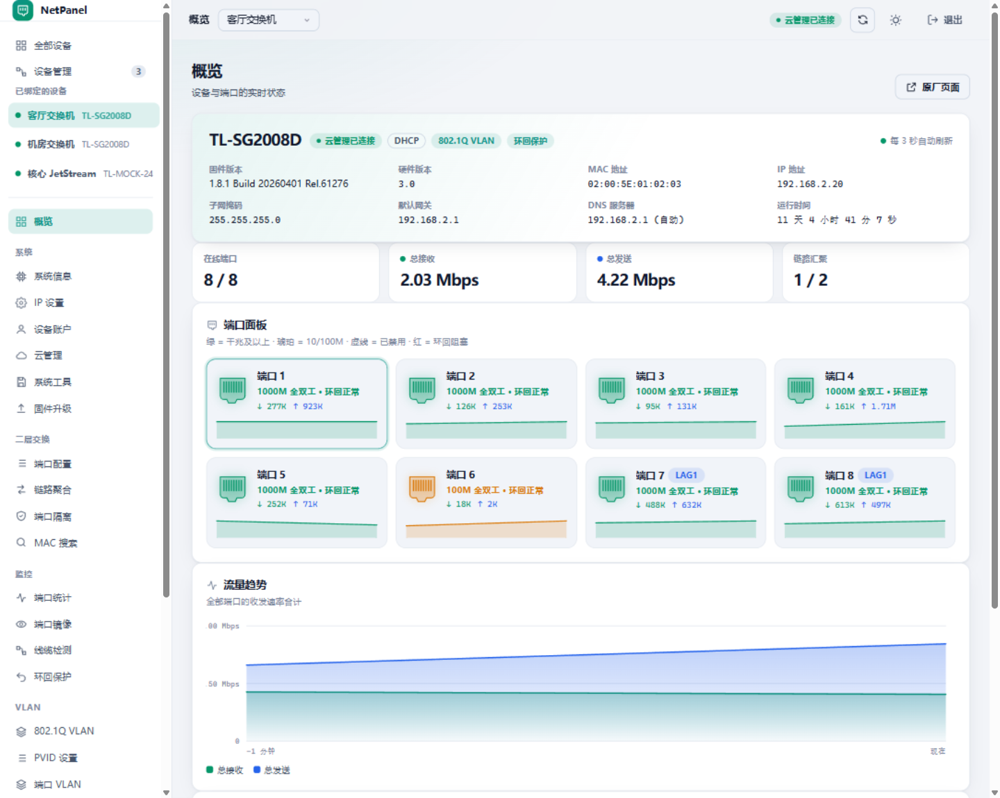
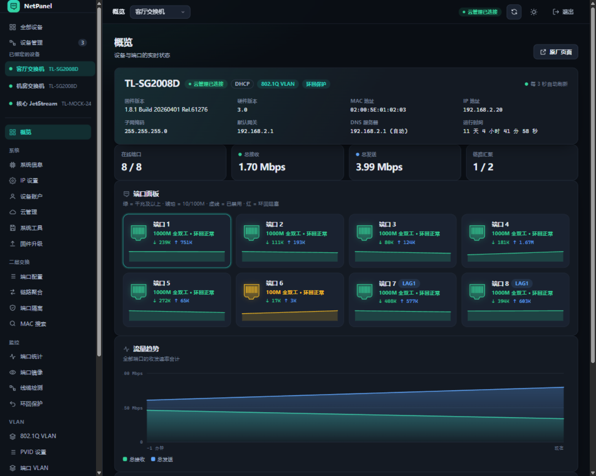
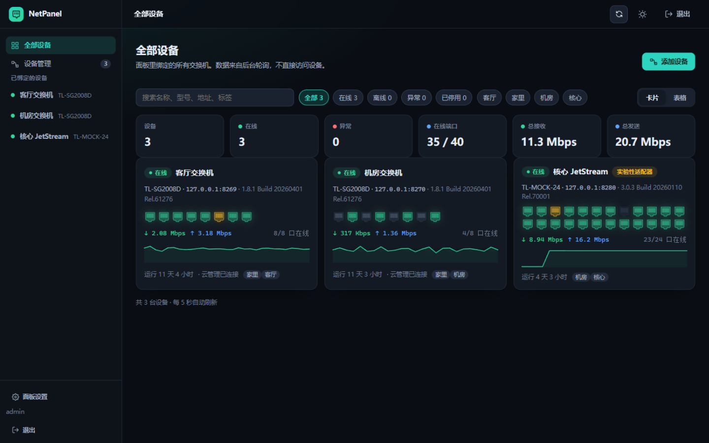
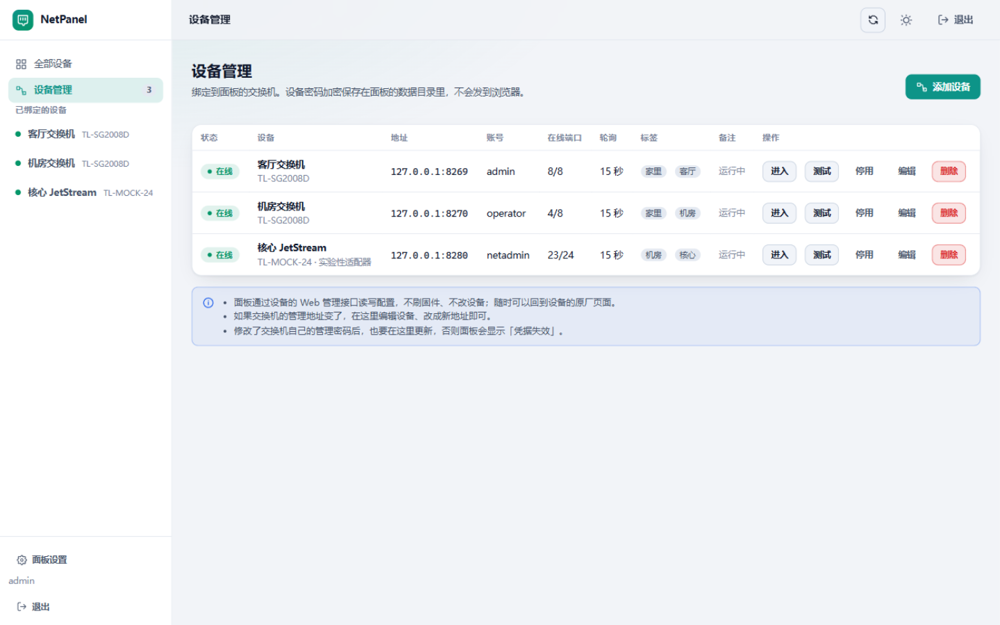
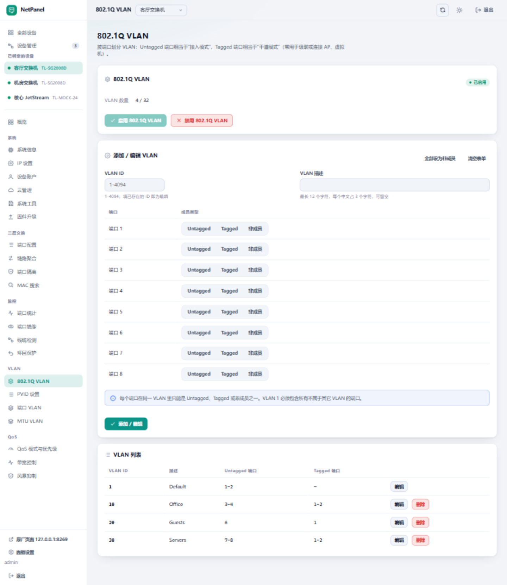
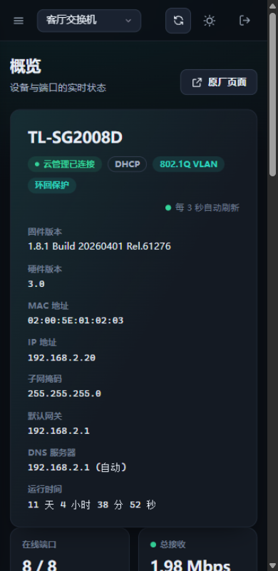
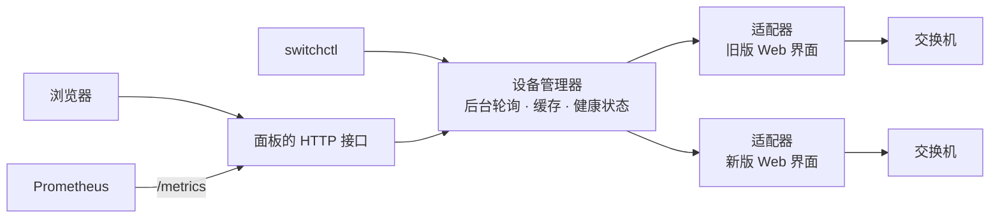

# NetPanel

[](https://github.com/LceAn/netpanel/actions/workflows/ci.yml)
[](app/package.json)
[](https://nodejs.org)
[](LICENSE)
[](app/package.json)

**自托管的局域网交换机管理面板。** 一个面板管理多台交换机，界面重新做了一遍，顺带把 Prometheus 指标和命令行补上。

它不刷固件、不改硬件，只是通过交换机自己的 Web 管理接口读写配置——随时可以回到原厂页面。
目前实测 **TP-LINK TL-SG2008D**；JetStream 新界面（T1600G / T2600G 一类）是实验性只读适配，详见[支持的设备](#支持的设备)。
想直接跑起来？跳到[快速开始](#快速开始)。



> 非官方项目，与 TP-LINK 无关联。修改配置、重启、升级固件会改动正在运行的设备，使用前请看[验证情况](#验证情况)。

## 为什么要有它

原厂的 Web 界面能用，但难用：一次只能管一台、每次登录都要输设备密码、页面是十几年前的风格。NetPanel 想解决的就是这些：

- **一个面板，多台交换机。** 绑定一次，之后所有交换机在同一个页面里，带在线状态和流量趋势。
- **零依赖。** 只要 Node.js ≥ 20。不用 `npm install`，没有构建步骤，没有数据库。
- **自己的账号。** 面板有管理员账号；交换机的密码加密保存在面板的数据目录里，浏览器不再需要知道它。
- **一套模型，四处复用。** 面板把交换机的数据整理成统一的模型，界面、接口、指标、命令行都只认这套模型——新增一种设备只需要加一个适配器。
- **不替你冒险。** 写操作走白名单，参数先校验再发送，写请求绝不自动重试；危险操作必须二次确认。

## 功能

**多设备**

- 绑定、编辑、停用、删除交换机；添加时自动识别厂商 / 型号 / 固件 / 端口数
- 总览页：每台一张卡片（在线状态、端口小图、收发流量与趋势、运行时间），支持搜索、按状态和标签筛选、表格视图
- 侧边栏按设备组织功能菜单，顶栏可在设备之间切换并停留在同一功能页
- 面板在后台轮询并缓存，开多少个标签页都不会增加交换机的负担

**设备管理**（以已适配的 TL-SG2008D 为例，原厂 22 个功能页全部覆盖）

| 分组 | 页面 |
|---|---|
| 概览 | 设备信息、云管理状态、端口面板（实时速率 + 迷你趋势）、流量趋势、单端口快捷配置 |
| 系统 | 系统信息、IP 设置、固定 IP、设备账户、云管理、系统工具（保存配置 / 备份 / 还原 / 重启 / 恢复出厂）、固件升级（在线与本地） |
| 二层交换 | 端口配置、链路聚合、端口隔离、MAC 搜索 |
| 监控 | 端口统计（含单口报文明细和实时速率）、端口镜像、线缆检测、环回保护 |
| VLAN | 802.1Q VLAN、PVID、端口 VLAN、MTU VLAN |
| QoS | QoS 模式与端口优先级、带宽控制、风暴抑制 |

**运维**

- `switchctl` 命令行：脚本、计划任务、SSH 里都能用；不依赖面板也能直接操作一台交换机
- `/metrics`：Prometheus 格式的指标（在线状态、端口链路与速率、流量、错误包……）

**界面**

深色 / 浅色主题，窄屏和手机可用，危险操作二次确认（恢复出厂需要输入 `RESET`）。

| 浅色 | 深色 |
|---|---|
|  |  |

<details>
<summary>更多截图：全部设备（深色）、设备管理、802.1Q VLAN、手机宽度</summary>

| 全部设备（深色） | 设备管理 |
|---|---|
|  |  |

| 802.1Q VLAN | 手机宽度 |
|---|---|
|  |  |

</details>

*截图里是模拟交换机的数据（<a href="#没有交换机也能体验">见下文</a>），设备名称、MAC、地址都是虚构的。*

## 支持的设备

| 设备 | 适配器 | 状态 |
|---|---|---|
| TP-LINK **TL-SG2008D**（硬件 3.0，固件 1.8.1） | `tplink-rpm` 旧版 Web 界面 | **已实测**：读取逐项核对过；不改变配置的写操作也在真机上执行过 |
| 使用同一套 `*Rpm.htm` 页面的其它 TP-LINK 交换机 | `tplink-rpm` | 协议相同，未逐一验证 |
| TP-LINK JetStream 系列，新版 Web 界面（如 T1600G / T2600G，固件 3.x） | `tplink-json` | **实验性，只读**：按公开的逆向资料实现，没有在真机上验证过 |

界面会按设备的能力显示它支持的页面；实验性适配器的设备会显示醒目的横幅，并且只能查看。

## 快速开始

需要 Node.js 20 或更高版本。

```bash
git clone https://github.com/LceAn/netpanel.git
cd netpanel/app
node server.mjs
```

打开 <http://127.0.0.1:8208>：

1. **创建面板的管理员账号**（只在第一次）。
2. 进入「设备管理」→「添加设备」，填交换机的地址和它自己的管理账号。
3. 点「测试连接」——面板会登录交换机，读出型号、固件和端口数。确认无误后保存。

Windows 下也可以直接双击 `app\start.cmd`。

面板默认只监听 `127.0.0.1`，只有本机能打开；要从局域网里的其它电脑访问，见[配置](#配置)。

交换机用的是 DHCP、地址变了？在「设备管理」里编辑那台设备的地址就行，不用改配置文件，也不用重启。

## Docker

```bash
docker build -t netpanel ./app
docker run -d --name netpanel --restart unless-stopped \
  -p 8208:8208 -v netpanel-data:/data netpanel
```

打开 `http://<主机>:8208`，同样先创建账号、再添加交换机。`/data` 是数据目录（设备表、密钥、面板账号、设置），用命名卷或自己的目录把它持久化。

容器要能访问到交换机所在的网段。默认的 bridge 网络一般可以；不行就加 `--network host`。

## 没有交换机也能体验

仓库里带了两个模拟交换机（一台旧版界面、一台新版界面），数据是虚构的，写操作随便试：

```bash
# 终端 1、2：两个模拟交换机
MOCK_PROFILE=lab node app/scripts/mock-switch.mjs 8269
node app/scripts/mock-json-switch.mjs 8280

# 终端 3：面板
PANEL_PORT=8210 node app/server.mjs
```

打开 <http://127.0.0.1:8210> 创建账号，然后添加 `http://127.0.0.1:8269`（账号、密码都是 `admin`）和 `http://127.0.0.1:8280`（`admin` / `admin`）。模拟器会把收到的每个写请求打印到控制台。

Windows CMD 没有 `VAR=value cmd` 这种写法，要先 `set MOCK_PROFILE=lab`、`set PANEL_PORT=8210`，再运行对应的命令。

## 命令行

```bash
cd app
node bin/switchctl.mjs help
```

（想直接敲 `switchctl`：`npm link`，或者加个别名。）

**两种用法：操作面板里已绑定的设备，或者临时指定一台交换机。**

```bash
export NETPANEL_PASSWORD='…'            # 交换机的密码 (不给会隐藏输入)

# 不经过面板, 直接看一台交换机 —— 自动识别它是哪一代设备
node bin/switchctl.mjs --url http://192.168.2.21 --user admin status

# 绑定到面板, 之后用名字或 id 指定
node bin/switchctl.mjs devices add 客厅交换机 http://192.168.2.20 --user admin --tags 家里
node bin/switchctl.mjs --device 客厅交换机 port set --ports 5,6 --speed 100f
node bin/switchctl.mjs --device 客厅交换机 save
node bin/switchctl.mjs --device 客厅交换机 backup --out "客厅-$(date +%F).cfg"
```

Windows PowerShell 里环境变量写成 `$env:NETPANEL_PASSWORD='…'`，其余参数不变。

读取、修改、备份、VLAN、QoS、固件检查……全部命令都支持 `--json`，方便接 `jq`。**面板运行期间也可以用命令行**，两边改的是同一份数据。

完整的命令列表、选项、退出码和危险操作的确认方式见 **[docs/cli.md](docs/cli.md)**。

## Prometheus 指标

```text
GET /metrics        需要 Bearer 令牌 (设置页 →「显示」, 或 switchctl token)
```

```yaml
scrape_configs:
  - job_name: netpanel
    authorization:
      type: Bearer
      credentials: <访问令牌>
    static_configs:
      - targets: ['panel.lan:8208']
```

`switch_up`、`switch_uptime_seconds`、`switch_port_up`、`switch_port_speed_bytes`、`switch_port_rx_rate_bytes` / `tx_rate_bytes`、`switch_port_rx_packets_total` / `errors_total`、`switch_cloud_connected` 等，标签为 `device`、`name`、`port`。指标读的是后台轮询的缓存，抓取再频繁也不碰交换机。完整列表和常用查询见 **[docs/api.md](docs/api.md#prometheus-指标)**。

## 配置

环境变量优先，其次 `app/config.json`（参考 `app/config.example.json`），都没有就用默认值：

| 环境变量 | `config.json` | 默认 | 含义 |
|---|---|---|---|
| `PANEL_HOST` | `host` | `127.0.0.1` | 监听地址 |
| `PANEL_PORT` | `port` | `8208` | 端口 |
| `PANEL_DATA_DIR` | `dataDir` | `app/data` | 数据目录 |
| `PANEL_CONFIG` | — | `app/config.json` | 配置文件路径 |

交换机的地址**不在**配置文件里：在界面或命令行里添加，保存在数据目录中。

### 让局域网里的其它电脑访问

把监听地址设为 `0.0.0.0`（`PANEL_HOST=0.0.0.0` 或 `config.json` 里 `"host": "0.0.0.0"`），然后访问 `http://<这台电脑的 IP>:8208`。

面板本身只提供明文 HTTP；交换机的管理接口也是明文 HTTP。**只建议在可信的内网里这样用**，跨公网请放在带 TLS 的反向代理之后或通过 VPN。

## 它是怎么工作的



1. **面板用自己的账号登录。** 交换机的密码在添加设备时加密保存（AES-256-GCM），之后只在面板进程的内存里解密使用。
2. **适配器把设备的数据整理成统一的模型。** 界面、接口、指标、命令行都只认这套模型，不接触设备的原始数据。新增一种设备就是新增一个适配器。
3. **写操作走白名单。** 每个操作照搬原厂表单的提交方式（路径、编码、字段名），参数先校验再发送，没有任何“把请求原样转发给交换机”的通道。写请求不自动重试，连接中断时明确提示“结果未知”。
4. **安全边界清楚。** 面板的写接口要求同源并带自定义请求头（防跨站伪造）；页面不拼接 HTML 字符串，设备返回的任何文本都作为纯文本显示；密码永远不会返回给浏览器。

想了解细节：[架构](docs/architecture.md) · [安全模型](docs/security.md) · [设备接口是怎么逆向出来的](docs/protocol.md)

## 项目结构

```
netpanel/
├─ app/                         面板本体
│  ├─ server.mjs                启动入口
│  ├─ bin/switchctl.mjs         命令行入口
│  ├─ src/
│  │  ├─ adapters/              每种设备协议一个目录 (tplink-rpm / tplink-json)
│  │  ├─ core/                  与设备无关的部分: 模型、操作、设备管理器、存储、指标
│  │  ├─ http/                  HTTP 服务: 路由、登录态、请求解析
│  │  └─ cli/                   switchctl 的实现
│  ├─ web/                      前端 (原生 ES 模块, 无框架)
│  ├─ scripts/                  模拟交换机
│  └─ test/                     测试与合成数据
├─ docs/                        文档
├─ tools/                       逆向分析时用的只读探测脚本
└─ .github/workflows/           CI: Node 20 / 22 / 24 跑测试, 构建 Docker 镜像
```

## 测试

```bash
cd app && node --test
```

185 项测试，约 13 秒，不需要安装任何东西，也不需要真机：

- 单元测试：解析器、模型、操作校验与编码、存储与加密、指标格式
- 进程内集成：用内存里的假适配器测设备管理器和 HTTP 接口的各种状态（离线、凭据失效、并发修改……）
- 端到端：真实的适配器 + 模拟交换机 + 真实监听的面板，把初始化、登录、绑定设备、轮询、读写、指标、命令行完整走一遍
- 契约：把每一个写操作逐个打到模拟交换机上。模拟交换机只接受原厂表单的提交方式（不对就断开连接，和真机一样），哪个操作的编码出了错都会在这里被拦下

## 验证情况

诚实地说清楚哪些测过、哪些没测：

- **读取**：已在真机上（TL-SG2008D）逐项核对，和原厂页面一致。
- **写入**：每个操作的提交方式都对照原厂页面的表单逐条核对过（[docs/protocol.md](docs/protocol.md)）。其中不改变配置的那部分在真机上执行过，设备回答“操作成功”，执行前后配置没有变化：端口配置、端口快捷设置、清空统计、环回保护、QoS 模式、802.1Q VLAN 的添加和删除、PVID、MAC 搜索、线缆检测、配置备份、固件的在线检查与冲突检测。
- **没有在真机上执行过的写入**：保存配置、重启、恢复出厂、还原配置、升级固件、修改 IP、修改账户、云管理——它们会改动正在运行的设备。请求格式和上面实测过的操作出自同一类表单，但第一次使用时仍请**先备份配置**，并从无关紧要的操作开始（例如保存配置、修改一个没人用的端口）。
- **多设备、指标导出、命令行**：在模拟环境里完整测试（自动化测试 + 浏览器实测）。面板同时管理多台真机的场景还没有实测过。
- **新版 Web 界面的适配器**：没有在真机上验证过，所以只提供读取。你手上有这类设备的话，[帮忙验证](docs/adapters.md#你可以帮忙验证)只需要做读操作。

## 已知限制与计划

- 只有一个管理员账号，没有多用户、权限分级和审计日志。
- 实验性的 `tplink-json` 适配器是只读的。
- PoE、光口这类功能：TL-SG2008D 没有，面板也就没做这些页面；同一页面体系的其它型号如果有，需要往规范模型里加字段并补页面。

计划中（也欢迎你来）：在真机上验证会改动设备的操作（保存、重启、还原、升级）；给新版界面的适配器补上写入（需要有人提供原厂界面的抓包）；更多厂商的适配器；PoE / 光口页面。

## 参与贡献

发现问题、想加新设备、想改界面都欢迎——见 [CONTRIBUTING.md](CONTRIBUTING.md)。安全问题请私下报告，见 [SECURITY.md](SECURITY.md)。

**文档**：[架构](docs/architecture.md) · [适配器与如何接入新设备](docs/adapters.md) · [设备接口协议](docs/protocol.md) · [HTTP 接口与指标](docs/api.md) · [命令行](docs/cli.md) · [安全模型](docs/security.md)

## 从 1.x 升级

2.0 把面板从“一台设备的页面”改成了“多设备的面板”，有几点不兼容：

- **面板有了自己的账号。** 第一次打开需要创建管理员账号，不再用交换机的账号登录。
- **交换机在界面里添加。** 环境变量 `SWITCH_URL` 和 `config.json` 里的 `switchUrl` 不再使用。
- **数据保存在 `app/data/`。** 请别把它提交到版本库。
- **HTTP 接口的路径变了**（设备相关的接口都在 `/api/devices/<id>/…` 下），防跨站请求头的值从 `switch-panel` 改成了 `netpanel`。如果你写过调用接口的脚本，请对照 [docs/api.md](docs/api.md) 调整。

### 2.0.0 → 2.0.1

2.0.0 把 33 个写操作里的 22 个（外加配置备份）用 POST 发送，而原厂页面是用 GET 提交这些表单的。
交换机只认原厂的方式，遇到别的方式会直接断开连接，所以这些操作在真机上不会生效（面板提示“结果未知”）；
读取、界面、指标、命令行不受影响。2.0.1 已修正，升级只需要更新代码并重启面板，数据目录不用动。

## 许可证

[MIT](LICENSE)。

## 免责声明

本项目按“现状”提供，不附带任何担保。用它修改配置、重启或升级固件造成的网络中断、配置丢失或设备故障，由使用者自行承担。动手前先备份配置。
